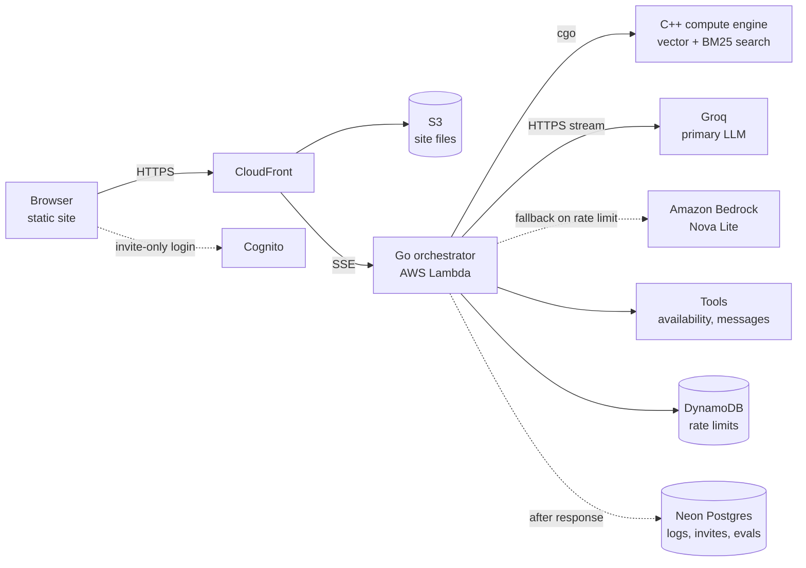

# Context Concierge

An AI assistant that answers questions from a set of documents, cites its sources, and shows
each step it takes and how long that step really took. The documents are kept apart from the
code: today they're built from my resume, but they could be any collection, and invitee-only
documents live in a separate private repo.

## Why

To show these in a working system rather than describe them:

- **An agent that's safe by construction.** The model can only propose actions; Go code decides
  what runs, and the search engine itself keeps private documents from anonymous visitors. A
  jailbroken model still can't do anything it isn't allowed to.
- **Speed and cost that are measured, not claimed.** Every timing on screen is real, retrieval
  is gated in CI, and the whole thing is designed to run for close to $0 a month.
- **Answers that are checked, by a checker that's tested.** A second model judges every answer
  against the passages it came from and flags unsupported claims. The judge is trusted only
  because its verdicts agreed with my own blind labels (10 of 10 on the latest sample), and that
  human review loop is repeatable with `make label`.
- **Attacks tested before launch** *(planned next)*. An adversarial suite of jailbreaks,
  system-prompt extraction, prompt injection hidden in documents, tool abuse and private-document
  leaks, each with canary strings and an expected safe outcome.
- **AI-assisted delivery under human review.** Built with an AI coding agent, test-first, with
  every deviation from the plan and every review outcome recorded.

## How it works

A Go service finds the most relevant passages with a C++ search engine (vector and keyword
search combined), a hosted model answers from them (Groq, with Amazon Bedrock as a fallback), a
second model checks the answer against its sources, and every step streams to the browser as it
happens.

The target architecture on AWS (local today; see [Status](#status)):



Retrieval runs in-process through cgo, so there's no network hop on the hot path, and nothing a
visitor waits for touches the database. The full stack, model routing, request lifecycle and
evaluation approach are in [architecture in detail](docs/architecture.md).

## What you see

```
┌──────────────────────────────────┬──────────────────────────────────┐
│  THOUGHT STREAM (terminal view)  │  ACTION CARDS                    │
│                                  │                                  │
│  > rewriting follow-up question  │  ┌────────────────────────────┐  │
│  > retrieving: "go experience"   │  │ * Retrieval (C++)   0.4 ms │  │
│  > 4 chunks, top score 0.82      │  └────────────────────────────┘  │
│  > plan: answer + offer meeting  │  ┌────────────────────────────┐  │
│  > calling check_availability    │  │ * check_availability  8 ms │  │
│                                  │  └────────────────────────────┘  │
│  Answer: ... [1] [2]             │  ┌────────────────────────────┐  │
│                                  │  │ * Inference (Groq)         │  │
│  [ suggested questions ]         │  │   TTFT 210 ms · 480 tok/s  │  │
│  [ chat input              ⏎ ]   │  │   cached prompt: 1.9k tok  │  │
│                                  │  │ + Judge: grounded          │  │
│                                  │  └────────────────────────────┘  │
└──────────────────────────────────┴──────────────────────────────────┘
```

- **Left — Thought stream:** a terminal-style view of the model's reasoning and the agent's steps,
  streamed in real time over **[Server-Sent Events (SSE)](docs/concepts.md#sse)**, followed by the answer with numbered
  citations.
- **Right — Action cards:** one card per backend step (retrieval, each tool call, inference,
  judge). A card lights up the instant Go starts the step and shows its **measured** duration when
  it finishes. Numbers are always real, never mocked.
- **Suggested questions:** chips for the most common questions. Their answers are generated,
  judge-verified and stored at deploy time, so they appear instantly (`Inference: 0 ms
  (pre-verified)`), a direct contrast with live answers.

The left pane streams the model's reasoning and the answer with numbered citations. The right
pane shows one card per backend step (retrieval, each tool call, inference, judge), each with its
measured duration.

## What's measured

Laptop and AWS spike results so far; the method and every run are in
[benchmarks](docs/benchmarks.md#results).

| What | Result | Where |
|---|---|---|
| Hybrid retrieval, 2k chunks × 512 dims | p50 0.122 ms, p99 0.225 ms | Laptop; CI fails the build at p99 ≥ 1 ms |
| C++ vs pure Go, vector top-k | 0.097 ms vs 0.408 ms p50 | Laptop, same day, same contract |
| Groq gpt-oss-120b from Lambda | TTFT p50 198 ms, 483 tokens/s | Spike 1.5, n = 20 |
| Lambda cold start, Go + SSM key read | 205 ms | Spike 1.5, n = 1 |
| Retrieval hit@5, Titan embeddings | 58 / 61 public questions | CI gate at 0.95 |
| Answer evals, judged on Groq | 49 / 64 public questions pass (77%) | Baseline at temperature 0; report-only until run-to-run spread is measured |
| Suggested question, stored answer | p50 0.9 ms | `make dev` over loopback, n = 20 |
| CSS shipped | 1,894 bytes gzipped | Budget 15 KB, checked in CI |

End-to-end targets in the [latency budget](docs/benchmarks.md#latency-budget-one-live-chat-turn-warm-lambda)
(for example, first visible thought) are design targets until Phase 7 measures them on AWS.

End-to-end targets, such as time to first visible thought, stay design targets until they're
measured on AWS.

## Status

**Paused on 2026-11-16 while the website that will host it launches**
([design §15](docs/design.md#15-running-as-a-feature-of-cferrantedev)). It's built and evaluated
locally but not deployed yet. Next is the adversarial test suite, then a private deploy on AWS.

| Milestone | Proves | Status |
|---|---|---|
| **M1 Risks retired** | cgo on Lambda, Go SSE streaming, CloudFront passthrough, Groq speed | ✅ 2026-11-01 |
| **M2 Local end-to-end** | Full chat with thought stream and action cards on my laptop | ✅ 2026-11-02 |
| **M3 Safe and smart** | Real models, judge, golden + adversarial evals passing | In progress: 6.0–6.3 done, 6.4 (adversarial) next |
| **M4 Private deploy** | Running on AWS, reachable only by me | Not started (Phase 7) |
| **M5 Public launch** | Invite-only features, logging, privacy, measured benchmarks | Not started (Phases 8–10) |

## Stack

Built: Go · C++ retrieval engine via cgo · Groq (gpt-oss) with an Amazon Bedrock fallback ·
Titan embeddings · plain HTML and JS with Tailwind CSS. Planned for the deploy: AWS Lambda,
CloudFront, Cognito, DynamoDB, Neon Postgres and OpenTofu. No LLM framework: every provider sits
behind one small Go interface.

## Try it locally

Requires Go, a C++17 compiler, CMake and [Ollama](https://ollama.com) running natively.
`make tools` fetches pinned, checksum-verified copies of the
[Tailwind CSS standalone CLI](https://tailwindcss.com/docs/installation/tailwind-cli) and Deno
into `build/tools` (Tailwind alone is about 100 MB; check disk space first).

```bash
cp .env.example .env         # local settings; never secrets
ollama serve                 # start Ollama (stop with Ctrl+C or `systemctl stop ollama`)
ollama pull qwen3:4b         # ~2.6 GB, plus nomic-embed-text (~0.3 GB) for embeddings
make test                    # C++, Go, JS and shell tests, CSS checks
make dev                     # serve the page and /chat on 127.0.0.1:8787 over Ollama
make dev DEV_FLAGS=-invitee  # the same, as an invitee (private chunks and action tools)
make help                    # every target, including the live smokes and evals
```

On a CPU, Ollama answers take 30–100 s. For realistic speed, `CHAT_PROVIDER=groq` uses Groq
with the key read from SSM through your AWS SSO session (`aws sso login` first).

## How it was built

Spec first, then a step-by-step plan, then code, written test-first with
[Claude Code](https://claude.com/claude-code) as the coding agent. CI blocks merges that break
the rules, and every deviation and review outcome is logged in the plan.

| Read this | For |
|---|---|
| [Architecture in detail](docs/architecture.md) | Stack, model routing, performance, retrieval, evaluation, testing, cost and risks |
| [Design spec](docs/design.md) | Components, streaming protocol, model layer, tools and authorization, data model |
| [Plan](docs/plan.md) | Each step, the test that had to fail first, deviations, review outcomes and spike findings |
| [Benchmarks](docs/benchmarks.md) | Targets, measured results and the method behind each |
| [Concepts](docs/concepts.md) | Every term used here, explained |
